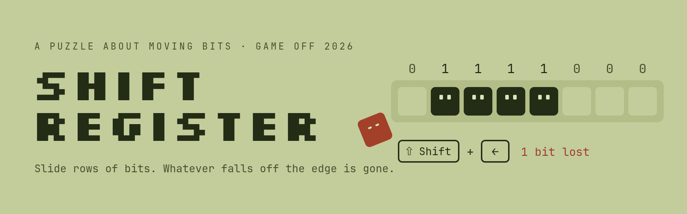
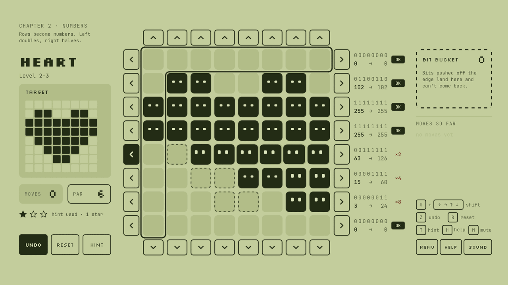
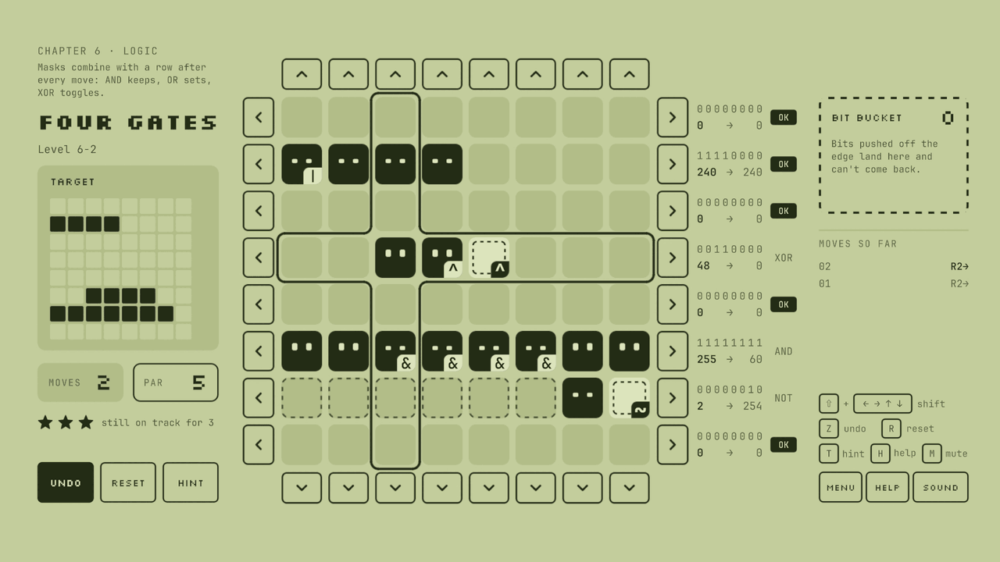
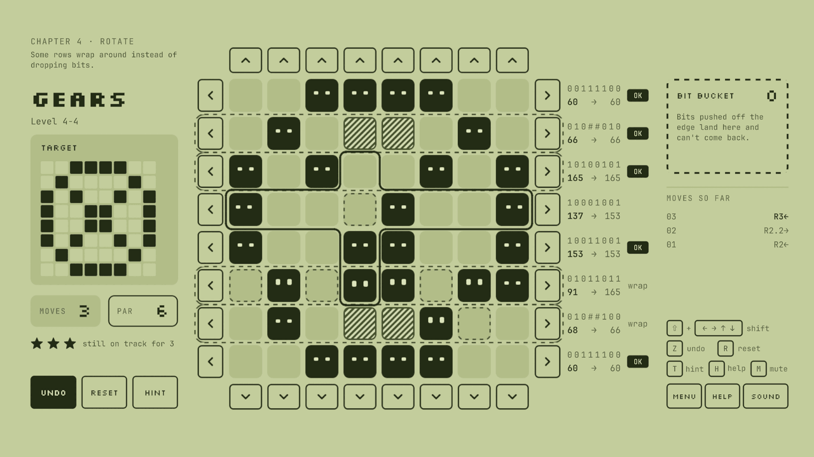
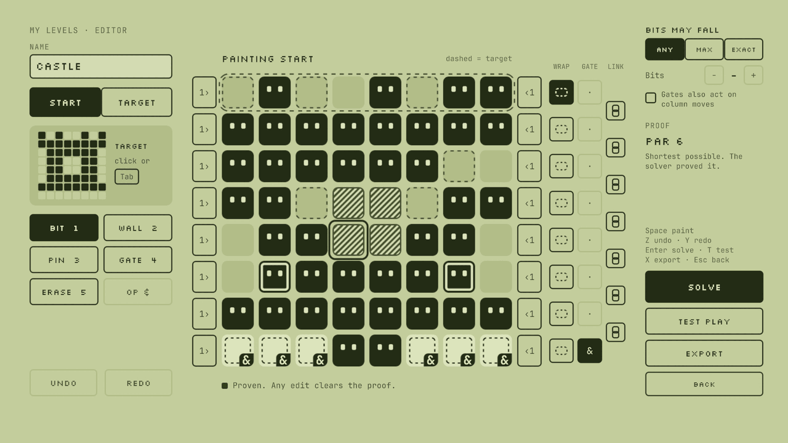
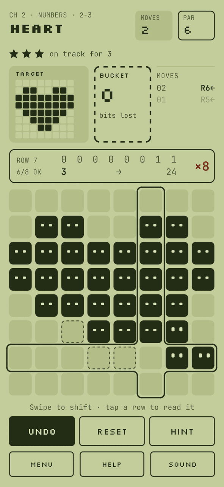

  

  
  
  
  
  

<a href="https://devplayrepeat.itch.io/shift-register">**Shift Register**</a> is a calm puzzle game on an 8×8 board of tiny bit creatures. You have exactly one move:
**shift**. Push a row left or right, or a column up or down, one cell at a time, until the board matches the
target picture. Bits that slide past the edge drop into the bit bucket and never come back.

One verb sounds easy. But every column you move runs through every row, so fixing one line breaks another. Most
puzzles come down to the game's one lesson: *to move this, first free that.*

  

## Theme: SHIFT

Made solo for **GitHub Game Off 2026**, whose theme is **SHIFT**, taken literally. A shift register is the
little circuit inside every computer that moves bits one place left or right. In code, `x << 1` doubles a
number, `x >> 1` halves it, and any bit that slides off the end is lost.

That is exactly what the board does. Every row is also an 8-bit number (the leftmost bit is worth 128), and the
readout next to it shows the row in binary with its value *now → target*. Shift `00111100` left and 60 becomes
120. So you can solve by eye, by drawing the picture, or by arithmetic: this row needs ×2, that one ×8.

## Features

- **30 handmade puzzles in six chapters.** Each chapter adds one rule: basics, numbers, walls and pins, wrapping
  rows, 16-bit carry rows and logic gates (AND, OR, XOR, NOT). Every par is checked by a solver, so par really is
  the shortest solution.
- **Endless random levels** in three difficulties, each one checked to be solvable.
- **A level editor** with share codes. Every code carries its solution, so an imported level is always solvable.
  A public [gallery](https://shift-register-levels.devplayrepeat.workers.dev) collects levels made by players.
- **Hints** that show one next move, acted out by the bits themselves.
- **Living bits** that lean into a shift, peek over the edge, nap while you think and pile up in the bucket. One
  option turns them into plain bits.
- **Plays everywhere:** in the browser on desktop and phones (portrait or landscape), plus Windows, Linux and
  Android builds. Sound effects are synthesized in code.

<table>
  <tr>
    <td width="50%"></td>
    <td width="50%"></td>
  </tr>
  <tr>
    <td align="center">Chapter 6: AND, OR, XOR and NOT gates</td>
    <td align="center">Chapter 4: rows that wrap around</td>
  </tr>
  <tr>
    <td width="50%"></td>
    <td width="50%" align="center"></td>
  </tr>
  <tr>
    <td align="center">The level editor</td>
    <td align="center">On a phone</td>
  </tr>
</table>

## Controls

| Keyboard and mouse | |
|---|---|
| <kbd>←</kbd> <kbd>→</kbd> <kbd>↑</kbd> <kbd>↓</kbd> or <kbd>W</kbd> <kbd>A</kbd> <kbd>S</kbd> <kbd>D</kbd> | move the cursor |
| <kbd>Shift</kbd> + arrow | shift the row or column under the cursor |
| drag a row or column | shift it, one cell per cell dragged |
| click an arrow button | shift that row or column |
| <kbd>Z</kbd> undo · <kbd>R</kbd> reset · <kbd>T</kbd> hint | <kbd>Enter</kbd> next level |
| <kbd>H</kbd> help · <kbd>M</kbd> mute | <kbd>Esc</kbd> menu |

On phones and tablets, swipe a row or column to shift it and tap a cell to read its row. The level editor needs
landscape; playing works either way up.

## Building from source

You need **Unity 6000.6.7f1** (Unity 6.6) with WebGL, Linux, Windows (Mono) and Android build support for the
targets you want.

1. Clone the repository and open the folder in Unity Hub.
2. Open `Assets/Scenes/Game.unity` and press Play.
3. Build with **Shift Register > Build > Web / Windows / Linux / Android APK**. The builds land in `Builds/`.

The tests are in `Assets/Tests/EditMode` and run from **Window > General > Test Runner**. After editing a level,
run **Shift Register > Validate and Solve Levels**, which checks every level and writes its par and solution.

## Repository layout

| Path | What is there |
|---|---|
| [`Assets/Scripts/Core`](Assets/Scripts/Core) | The rules, solver, hint search, random level generator and share codes. Plain C# with no Unity dependencies. |
| [`Assets/Scripts/Game`](Assets/Scripts/Game) | Board view, input, HUD, menus, level editor and sound. |
| [`Assets/Scripts/Editor`](Assets/Scripts/Editor) | Build menu and level tools. |
| [`Assets/Levels`](Assets/Levels) | The 30 levels as JSON, with [the level format](Assets/Levels/README.md). |
| [`Assets/Tests`](Assets/Tests) | EditMode tests. |
| [`Tools/LevelGenerator`](Tools/LevelGenerator) | Command-line harness for designing level candidates ([README](Tools/LevelGenerator/README.md)). |
| [`Tools/ShareCodeVectors`](Tools/ShareCodeVectors) | Writes the test vectors that keep the web page's share code reader in line with the game. |
| [`Web`](Web) | The shared level gallery on Cloudflare Workers and D1 ([README](Web/README.md)). |

## License

Shift Register is free software: you can redistribute it and/or modify it under the terms of the
[GNU General Public License](LICENSE), version 3 or (at your option) any later version, with an
additional permission to combine it with the Unity engine and Unity packages. See [COPYING.md](COPYING.md)
for the notice.

The dev.play.repeat logo is not covered by the GPL: all rights reserved, so forks must remove or replace it.

The fonts [Silkscreen](https://github.com/googlefonts/silkscreen) and
[JetBrains Mono](https://github.com/JetBrains/JetBrainsMono) are under the SIL Open Font License 1.1, and the
TextMesh Pro resources are under the Unity Companion License. [COPYING.md](COPYING.md) lists these files.

---

Design, code and levels by <b>dev.play.repeat</b> · made with Unity 6

